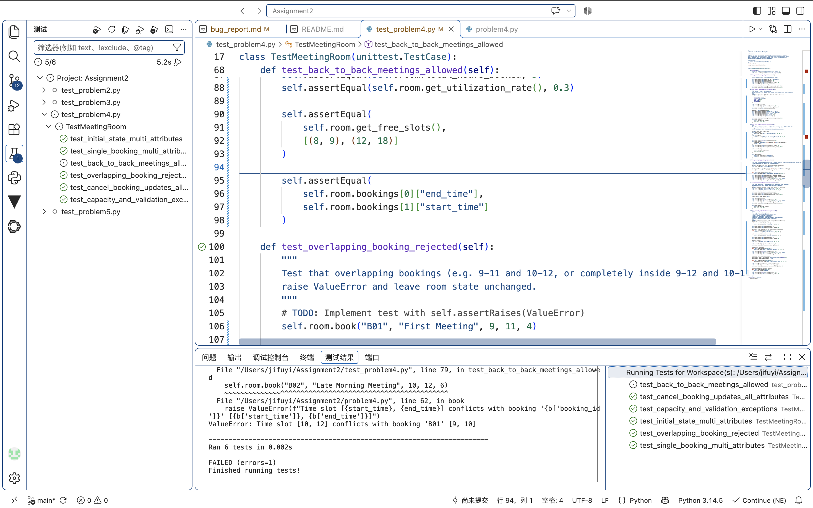
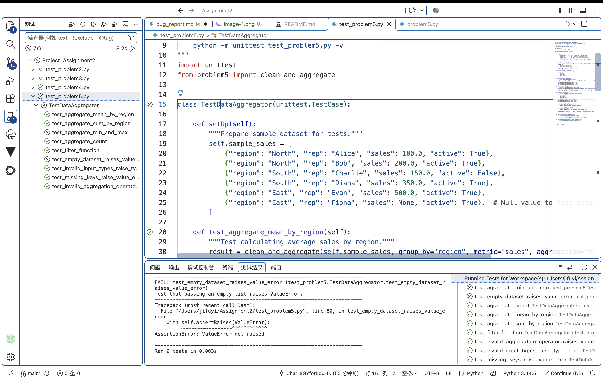

# Bug Report

This report documents the bugs discovered in the buggy programs, including the failing test cases, root cause analysis, and the applied code fixes.

---

## Bug Report 1: (Example)

### 1. Program Under Test
- **File:** `problemX.py`
- **Class / Function:** `YourClassName.method_name()`

### 2. Failing Test Case
Provide the unit test code from `test_problemX.py` that exposed the bug and failed during execution:

```python
# Paste your failing test method here
def test_example_failure(self):
    pass
```

Provide the captured test runs from VSCode.


**Test Output / Error Message:**
```text
# Paste error traceback / assertion failure message here
```

### 3. Root Cause Analysis
Explain why the bug occurred and what incorrect behavior it caused:
- **Expected Behavior:** (What should happen according to the specifications)
- **Actual Behavior:** (What happened in the starter code)
- **Root Cause:** (Explanation of the bug in the code logic)

### 4. Code Fix & Diff
Show the changes made to `problemX.py` to fix the bug:

```diff
- # Original buggy code line
+ # Corrected code line
```

---

## Bug Report 2: (Your discovery)

Write down your discovered bugs and solutions to address them as above. You may add more bug reports if needed.

### 1. Program Under Test
- **File:** `problem4.py`
- **Class / Function:** `MeetingRoom.book()`

### 2. Failing Test Case
Provide the unit test code from `test_problem4.py` that exposed the bug and failed during execution:

```python
# Paste your failing test method here
def test_back_to_back_meetings_allowed(self):
        """
        Test that valid consecutive / back-to-back meetings (e.g. 9-10 and 10-12)
        are permitted without raising conflict errors.
        Verify multi-attribute state after both bookings succeed.
        """
        # TODO: Book 'B01' from 9 to 10
        self.assertTrue(
            self.room.book("B01", "Morning Meeting", 9, 10, 5)
        )
        self.assertTrue(
            self.room.book("B02", "Late Morning Meeting", 10, 12, 6)
        )

        self.assertEqual(len(self.room.bookings), 2)
        self.assertEqual(
            [booking["booking_id"] for booking in self.room.bookings],
            ["B01", "B02"]
        )
        self.assertEqual(self.room.total_hours_booked, 3)
        self.assertEqual(self.room.get_utilization_rate(), 0.3)

        self.assertEqual(
            self.room.get_free_slots(),
            [(8, 9), (12, 18)]
        )

        self.assertEqual(
            self.room.bookings[0]["end_time"],
            self.room.bookings[1]["start_time"]
        )

```

Provide the captured test runs from VSCode.



**Test Output / Error Message:**
```text
# Paste error traceback / assertion failure message here
ERROR: test_back_to_back_meetings_allowed (test_problem4.TestMeetingRoom.test_back_to_back_meetings_allowed)
Test that valid consecutive / back-to-back meetings (e.g. 9-10 and 10-12)
----------------------------------------------------------------------
Traceback (most recent call last):
  File "/Users/jifuyi/Assignment2/test_problem4.py", line 79, in test_back_to_back_meetings_allowed
    self.room.book("B02", "Late Morning Meeting", 10, 12, 6)
    ~~~~~~~~~~~~~~^^^^^^^^^^^^^^^^^^^^^^^^^^^^^^^^^^^^^^^^^^
  File "/Users/jifuyi/Assignment2/problem4.py", line 62, in book
    raise ValueError(f"Time slot [{start_time}, {end_time}] conflicts with booking '{b['booking_id']}' [{b['start_time']}, {b['end_time']}]")
ValueError: Time slot [10, 12] conflicts with booking 'B01' [9, 10]
```

### 3. Root Cause Analysis
Explain why the bug occurred and what incorrect behavior it caused:
- **Expected Behavior:** According to the specifications, back-to-back meetings should be allowed. For example:
```
Existing booking: 9–10
New booking:      10–12
```
These meetings do not overlap because the first meeting ends exactly when the second begins. However, genuinely overlapping meetings, such as 9–11 and 10–12, should be rejected.
- **Actual Behavior:** The starter code incorrectly rejects back-to-back meetings as conflicts. For example, booking 10–12 after an existing booking from 9–10 raises:
```
ValueError: Time slot [10, 12] conflicts with booking 'B01' [9, 10]
```
- **Root Cause:** 
The original conflict check was:
```
if not (end_time < b["start_time"] or start_time > b["end_time"]):
```
It uses strict < and > comparisons. When one meeting ends exactly when another starts:
```
end_time == b["start_time"]
```
the condition considers the meetings to be overlapping.
The correct non-overlap conditions should include equality:
```
if not (
    end_time <= b["start_time"]
    or start_time >= b["end_time"]
):
```
Alternatively, the overlap condition can be written directly as:
```
if start_time < b["end_time"] and end_time > b["start_time"]:
```
This allows adjacent intervals while still rejecting actual overlaps.

### 4. Code Fix & Diff
Show the changes made to `problem4.py` to fix the bug:

```diff
- if not (end_time < b["start_time"] or start_time > b["end_time"]): # Original buggy code line
+ if not (end_time <= b["start_time"] or start_time >= b["end_time"]): # Corrected code line
```

---

## Bug Report 3: 

### 1. Program Under Test
- **File:** `problem5.py`
- **Class / Function:** `clean_and_aggregate()`

### 2. Failing Test Case
Provide the unit test code from `test_problem5.py` that exposed the bug and failed during execution:

```python
# Paste your failing test method here
def test_aggregate_min_and_max(self):
    """Test min and max aggregation operations."""
    min_result = clean_and_aggregate(
        self.sample_sales,
        group_by="region",
        metric="sales",
        aggregation="min"
    )
    max_result = clean_and_aggregate(
        self.sample_sales,
        group_by="region",
        metric="sales",
        aggregation="max"
    )

    self.assertAlmostEqual(min_result["North"], 100.0)
    self.assertAlmostEqual(max_result["North"], 200.0)
    self.assertAlmostEqual(min_result["South"], 150.0)
    self.assertAlmostEqual(max_result["South"], 350.0)
    
def test_empty_dataset_raises_value_error(self):
    """Test that passing an empty list raises ValueError."""
    with self.assertRaises(ValueError):
        clean_and_aggregate([], group_by="region", metric="sales")
```

Provide the captured test runs from VSCode.



**Test Output / Error Message:**
```text
# Paste error traceback / assertion failure message here
FAIL: test_aggregate_min_and_max (test_problem5.TestDataAggregator.test_aggregate_min_and_max)
Test min and max aggregation operations.
----------------------------------------------------------------------
Traceback (most recent call last):
  File "/Users/jifuyi/Assignment2/test_problem5.py", line 53, in test_aggregate_min_and_max
    self.assertAlmostEqual(min_result["North"], 100.0)
    ~~~~~~~~~~~~~~~~~~~~~~^^^^^^^^^^^^^^^^^^^^^^^^^^^^
AssertionError: 200.0 != 100.0 within 7 places (100.0 difference)

======================================================================
FAIL: test_empty_dataset_raises_value_error (test_problem5.TestDataAggregator.test_empty_dataset_raises_value_error)
Test that passing an empty list raises ValueError.
----------------------------------------------------------------------
Traceback (most recent call last):
  File "/Users/jifuyi/Assignment2/test_problem5.py", line 80, in test_empty_dataset_raises_value_error
    with self.assertRaises(ValueError):
         ~~~~~~~~~~~~~~~~~^^^^^^^^^^^^
AssertionError: ValueError not raised
```

### 3. Root Cause Analysis
Explain why the bug occurred and what incorrect behavior it caused:
- **Expected Behavior:** The function should calculate min using the smallest value and max using the largest value. It should also raise ValueError when records is empty.
- **Actual Behavior:** The starter code reverses the min and max results. For example, North’s minimum is returned as 200.0 instead of 100.0. It also returns {} for an empty list instead of raising ValueError.
- **Root Cause:** The min and max branches call the wrong built-in functions:
```
elif agg_op == "min":
    val = max(values)
elif agg_op == "max":
    val = min(values)
```

### 4. Code Fix & Diff
Show the changes made to `problem5.py` to fix the bug:

```diff
# Original buggy code line
-        elif agg_op == "min":
-            val = max(values)
-        elif agg_op == "max":
-            val = min(values)
# Corrected code line
+        elif agg_op == "min":
+            val = min(values)
+        elif agg_op == "max":
+            val = max(values)

# Corrected code line，将这四句加在 clean_and_aggregate() 函数的开头，放在 valid_aggregations 之前。
+ if not isinstance(records, list):
+     raise TypeError("records must be a list")
+ if not records:
+     raise ValueError("records cannot be empty")
```
